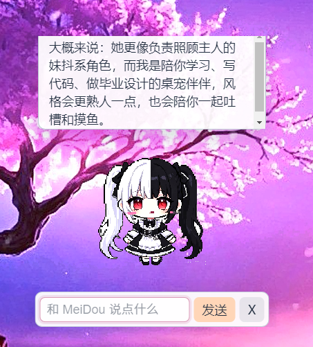
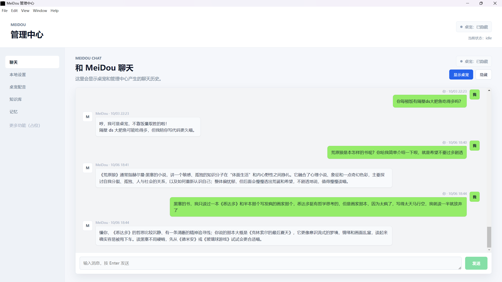
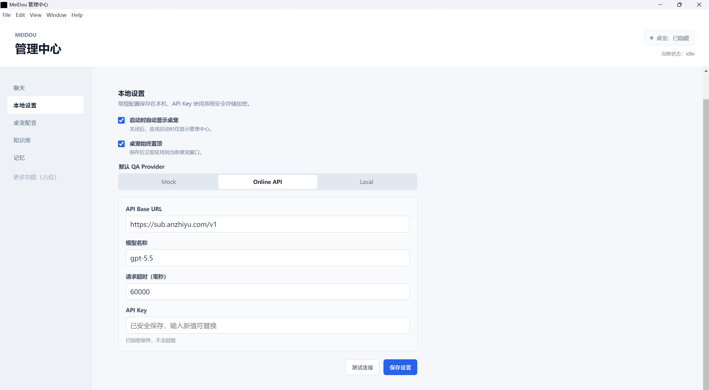
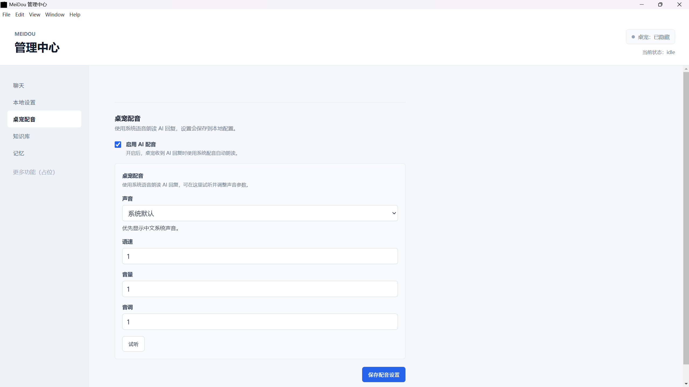
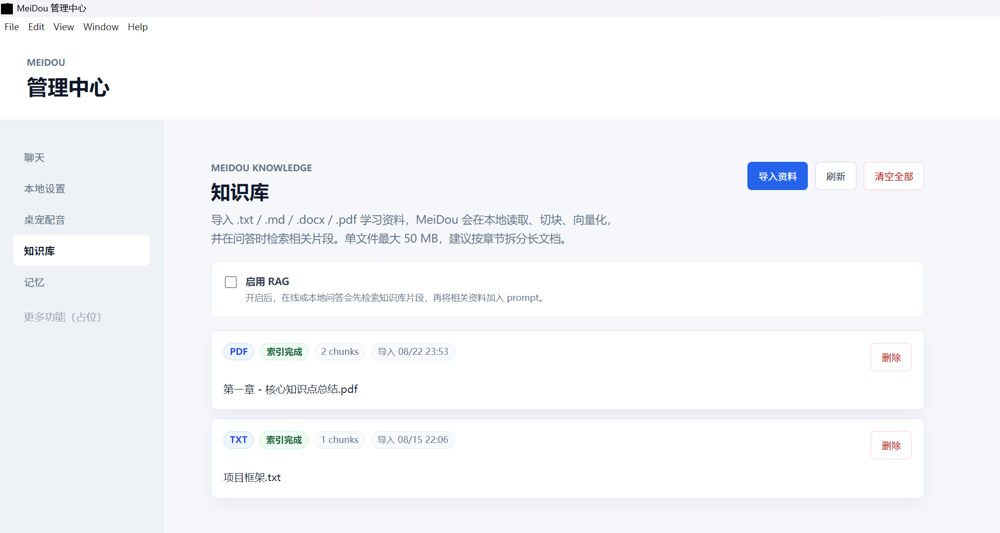
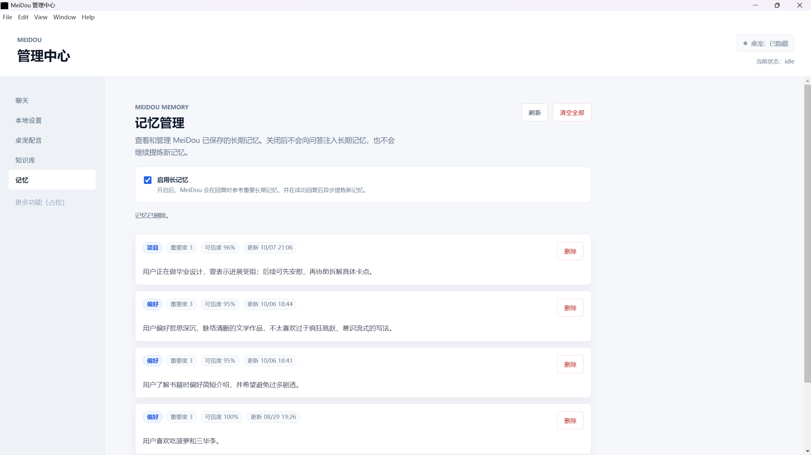
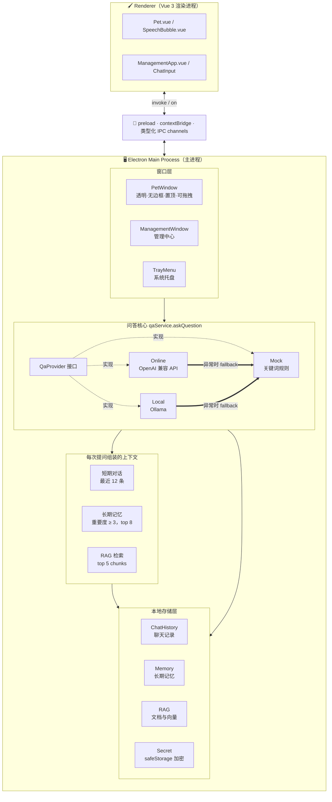

# MeiDou · 妹抖酱

> 一个住在 Windows 桌面上的 AI 桌宠：透明置顶、会聊天、能读你导入的资料，也会慢慢记住你。

基于 **Electron + Vue 3 + Vite + TypeScript** 构建的 Windows 桌面端个人 AI 陪伴应用。项目名称和角色概念受到相关作品启发，希望它不只是一个会回复的对话框，而是一个常驻在桌面角落、有记忆、有知识库、有性格的小存在。

> [!NOTE]
> 当前为 V1 版本，个人学习项目。项目目前仅支持 Windows。桌宠立绘使用的是开发阶段临时素材，公开发布前请替换为原创或已获授权的素材。

---

## ✨ 功能特性

- 🐾 **双窗口架构**：透明、无边框、可拖拽、置顶的桌宠窗口 + 独立的管理中心窗口，关闭桌宠窗口后进程仍由系统托盘托管。
- 💬 **AI 聊天**：支持 Markdown 渲染回复（经 DOMPurify 消毒防 XSS），桌宠与管理中心共享同一份聊天历史。
- 🔌 **多模型接入（策略模式）**：内置 Mock / OpenAI 兼容 Online API / 本地 Ollama 三种 Provider，管理中心一键切换；远端 Provider 异常时自动降级到 Mock，不会让界面卡死。
- 📚 **本地 RAG 知识库**：导入 `.txt` / `.md` / `.docx` / `.pdf`，本地切块、向量化、余弦相似度检索，**不依赖任何外部向量数据库**；回答末尾自动标注来源片段。
- 🧠 **长期记忆**：每轮对话结束后异步调用 LLM 提炼记忆，按 `事实 / 偏好 / 项目 / 情绪 / 待办` 分类，带重要度与可信度双阈值过滤，并内置敏感信息拦截（API Key、密码、身份证、银行卡等）。
- 🎙️ **系统 TTS 配音**：调用系统语音合成朗读 AI 回复，可调节语速 / 音量 / 音调，支持试听，优先枚举中文语音。
- 🔐 **密钥安全存储**：Online API Key 通过 Electron `safeStorage`（Windows 下基于 DPAPI）加密落盘，界面不会回显已保存的明文 Key。
- 🖥️ **管理中心**：独立窗口，左侧功能导航与右侧内容区独立滚动，集中管理聊天、设置、配音、知识库、长期记忆。

---

## 📸 截图

桌宠平时处于半睡半醒的状态，提问时会变得活跃：




管理中心集中管理 Provider 切换、在线模型配置、TTS 配音、知识库与长期记忆：











---

## 🛠 技术栈

| 层 | 技术 |
|---|---|
| 桌面框架 | Electron 33 |
| 前端 | Vue 3（`<script setup>` Composition API）+ Vite |
| 语言 | TypeScript（主进程 / preload / 渲染进程全量 TS） |
| Markdown | `marked` + `dompurify` |
| 文档解析 | `pdfjs-dist`（PDF）、`mammoth`（DOCX） |
| 本地存储 | JSON 文件 + Electron `safeStorage` |
| 打包 | electron-builder（NSIS 安装包） |

---

## 🏗 架构设计



### 关键设计决策

- **QaProvider 策略模式**：`qa/providers/` 下三个实现统一满足 `QaProvider` 接口，新增模型后端只需实现 `ask(question, context)` 并在 `getQaProvider` 注册，`qaService` 无需改动。
- **Provider 降级**：Online / Local 请求失败时自动 `catch` 并回落到 Mock Provider，保证管理中心和桌宠在模型不可用时仍可交互，不会白屏。
- **三层上下文组装**：每次提问前，`qaService` 会拼装短期对话（最近 12 条）+ 长期记忆（重要度 ≥ 3 的最多 8 条）+ RAG 检索片段（top 5），统一注入 prompt。
- **零依赖 RAG**：文档切块使用固定滑窗（默认 1000 字符，150 字符重叠，参数 clamp 在安全区间），检索时全量加载 chunk 到内存做**手写的余弦相似度**排序（含维度校验与零向量保护，并对单位向量、正交向量、零向量等典型场景做了断言校验），单文件最多 500 chunk。
- **异步记忆提炼**：回复成功后才异步触发 `extractMemoriesFromExchange`，不阻塞用户拿到回答；LLM 要求严格输出 JSON，解析层做了 code-fence 剥离、`{...}` / `[...]` 区间截取、类型与阈值归一化，容错模型"话多"。
- **敏感信息防泄漏**：记忆入库前用正则拦截 `sk-` 开头的 API Key、身份证、银行卡、密码等模式；prompt 层面也明确禁止保存敏感信息。
- **密钥不回显**：`safeStorage.encryptString` 后 base64 落盘到 `userData/secrets.json`，渲染进程通过 `hasOnlineApiKey` 只拿到布尔值，输入框显示“已加密保存”。这不代表密钥在所有系统环境下绝对安全，安全性仍依赖于当前 Windows 用户账户和系统环境。
- **单实例锁**：`requestSingleInstanceLock()` 防止多开；二次启动时聚焦已有窗口并唤起桌宠。

---

## 🚀 快速开始

### 环境要求

- Windows 10 / 11
- Node.js 18+（推荐 20 LTS）
- pnpm 9+

### 安装与运行

```bash
git clone <你的仓库地址>
cd MeiDou
pnpm install
pnpm dev
```

启动后会同时弹出两个窗口：透明桌宠 + 管理中心。首次启动桌宠默认显示，可通过托盘或管理中心隐藏。首次运行建议先在管理中心选择 `Mock` Provider，确认界面和基础功能正常后，再配置 Online API 或 Ollama。

### 打包安装包

```bash
pnpm build       # vue-tsc 类型检查 + electron-vite 构建
pnpm package     # electron-builder 打包 NSIS exe
```

产物输出在 `release/` 目录。

### 首次配置问答后端

项目默认支持 `Mock`、`Online` 和 `Local` 三种 Provider：

| Provider | 说明 |
|---|---|
| `Mock` | 关键词规则匹配，无需外部服务，适合离线体验界面和调试功能。 |
| `Online` | 支持 OpenAI 兼容的 `/v1/chat/completions` 接口，需要填写 Base URL、模型名和 API Key。 |
| `Local` | 使用本机 Ollama 服务，需要提前安装 Ollama 并准备至少一个模型。 |

使用 Ollama 时，可以先执行：

```bash
ollama pull qwen2.5:7b
ollama serve
```

实际模型名称可以根据本机安装的模型调整。

---

## ⚙️ 配置说明

所有配置都可以在「管理中心 → 本地设置」里完成，也支持用环境变量预置。

### 环境变量（可选）

```bash
# Windows PowerShell
$env:ONLINE_API_KEY="sk-..."
$env:ONLINE_API_BASE_URL="https://api.openai.com/v1"
$env:ONLINE_API_MODEL="gpt-4o-mini"
$env:ONLINE_API_TIMEOUT_MS="120000"
pnpm dev
```

请不要把真实 API Key 提交到 Git 仓库、截图或公开日志中。环境变量只对当前终端会话生效；也可以直接在管理中心配置，应用会将已保存的 Online API Key 加密存储在本机。

### 知识库

在「管理中心 → 知识库」导入 `.txt` / `.md` / `.docx` / `.pdf`（单文件 ≤ 50 MB，建议按章节拆分长文档）。导入后自动切块、向量化、建索引；RAG 开关可随时关闭，关闭后问答不再检索资料。导入文档前请确认其中不包含不适合发送给远程模型的敏感内容。

## 🔒 数据与隐私

- 聊天记录、长期记忆、知识库数据和应用配置默认保存在本机用户数据目录中。
- Online API Key 使用 Electron `safeStorage` 加密后保存，应用界面不会回显已保存的明文 Key。
- 使用 Online Provider 时，当前问题以及被选入上下文的聊天记录、长期记忆和知识库片段可能会发送给你配置的远程 API。
- 使用 Local Provider 时，问答请求发送到本机 Ollama 服务，不需要调用远程模型服务。
- 请根据实际使用的模型服务商隐私政策判断是否适合导入个人、公司或其他敏感资料。

---

## 📁 项目结构

```
MeiDou/
├── electron/
│   ├── main/                    # 主进程
│   │   ├── index.ts             # 入口：单实例锁、窗口创建、IPC 注册
│   │   ├── window/              # PetWindow / ManagementWindow
│   │   ├── tray/                # 系统托盘
│   │   ├── qa/                  # 问答核心
│   │   │   ├── qaService.ts     # askQuestion：组装上下文、调度 Provider
│   │   │   ├── providers/      # mock / online / local 三个 Provider
│   │   │   └── persona/        # 人格 prompt 模板与风格示例
│   │   ├── rag/                 # 本地 RAG：chunker / documentLoader / 向量检索
│   │   ├── memory/              # 长期记忆提取与注入
│   │   ├── storage/             # chatHistory / memory / rag / config / secret 存储
│   │   └── shims/               # pdf.js 等 Node 端垫片
│   ├── preload/                 # contextBridge 暴露给渲染进程的 API
│   └── shared/                  # IPC 通道名等主/渲染共享常量
├── src/
│   ├── App.vue                  # 桌宠渲染进程入口
│   ├── components/              # Pet.vue / SpeechBubble.vue / ChatInput.vue
│   ├── composables/             # useSpeechSynthesis（TTS）
│   └── management/             # 管理中心渲染进程
│       ├── ManagementApp.vue
│       ├── styles.css
│       └── components/MarkdownMessage.vue
└── management.html              # 管理中心入口 HTML
```

---

## 🗺 路线图

- [ ] RAG 检索结果与长期记忆的协同优化（当前两条链路相对独立，后续计划在 prompt 层做去重与优先级排序）。
- [ ] 聊天界面 UI 细节打磨（消息气泡、代码块高亮、滚动行为）。
- [ ] 替换临时立绘为原创 / 已授权精灵图，并补充更多状态动画。
- [ ] 持久化向量索引（当前为内存全量加载，文档量上去后需要引入轻量索引结构）。

## ⚠️ 素材与版权说明

项目名称和角色概念受到相关作品启发，本项目不是相关作品的官方项目，也不代表相关版权方。仓库中的桌宠立绘或其他临时素材仅用于开发测试；公开发布或商业使用前，应替换为原创素材或确认已获得相应授权。

---

## 🙏 致谢

- 项目概念受到鸭志田一《樱花庄的宠物女孩》相关设定启发。
- [Electron](https://www.electronjs.org/) / [Vue.js](https://vuejs.org/) / [Vite](https://vitejs.dev/) / [Ollama](https://ollama.com/)。
- 当前桌宠精灵图为开发阶段临时素材，公开发布前请确认授权或替换为原创素材。

## 📄 License

[MIT](./LICENSE)
